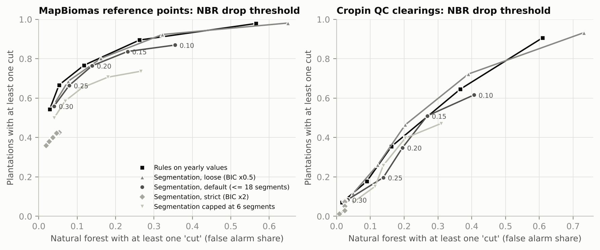

# Harvest cycles: does a pixel's cut-and-regrow history identify plantations?

## Short answer
**Yes. It is the strongest plantation signal we have tested so far.** A plantation pixel's Landsat history
(1985–2020 only) usually shows one or both of:
- a clear-cut followed by regrowth;
- trees appearing quickly on open land.

Natural forest usually stays closed every year.

- **MapBiomas reference points.** Adding the harvest history to the team's features raises the spatial-CV AUC
  from 0.91 to 0.97, in 25 of 25 held-out folds.
  - At ≤ 5% of real forest flagged, recall rises from 64% to 88%.
  - Caveat: MapBiomas' interpreters label these points by looking at the same Landsat archive, so these numbers
    are an upper bound.
- **Cropin's QC clearings: the independent test.** These are mostly smaller than one Landsat pixel. Models trained
  only on MapBiomas points reach AUC 0.76–0.81.
  - At ≈ 5–9% of QC forest flagged, they catch 33–45% of QC plantations; MapBiomas catches 4%.
- **"Forest every year since 1985" is a usable safe veto.**
  - MapBiomas points: it protects 45% of real forest and wrongly vetoes 1.6% of plantations.
  - Cropin QC: it protects 30% of forest and wrongly vetoes 6.1% of plantations.
- **Best use of the series:** continuous summaries of the NBR history. The best is how much NBR varied over
  1985–2020; the next is the largest 3-year fall. Both beat counting cycles on both datasets (paired 95% CIs exclude
  zero).
- **Regrowth speed does not work** as a feature.

All numbers come from `scripts/analysis.py`. Tables are in `results/`, figures in `figures/`, and the run log is
`results/analysis_log.txt`.

## What we did
- **Imagery**
  - Landsat 4/5/7/8 Collection 1 top-of-atmosphere reflectance, **1985–2020 only** (EUDR cutoff).
  - 8,063 low-cloud scenes, read pixel by pixel from Google's public bucket (no Earth Engine account).
  - After cloud masking and merging duplicate passes: a median of 6 clear observations per point and year.
    Only 0.4% of point-years have none; the worst year is 1998, with 10%.
  - Landsat 5 and 8 were put on the Landsat 7 scale with offsets measured on same-point pairs.
- **Index.** NBR (Normalized Burn Ratio: near-infrared vs shortwave-infrared 2). It drops sharply at a clear-cut and
  climbs back as trees regrow. NDVI was run alongside for comparison.
- **Points**
  - **MapBiomas reference points:** the same 1,831 points as the team's table `cropin_model_features_2022.csv`
    (429 plantation, 1,402 forest, no edge points).
  - **Cropin QC clearings:** 433 polygons (310 plantation, 123 forest; median 270 m²), one Landsat pixel at each.
    Only aggregate QC results are committed.
- **Thresholds come from Hansen, never from our labels, and use information up to 2020 only.**
  - "Closed canopy" is NBR 0.584: the 5th percentile of 2000–2020 values at 1,342 points with ≥ 90% Hansen tree
    cover in 2000 and no loss or gain.
  - "Open land" is NBR 0.405: the 25th percentile of the 1999–2001 values at 79 points with ≤ 10% tree cover.
  - A cut is an NBR fall of ≥ 0.20 within ≤ 3 years. A cycle is a cut that regrows ≥ 50% of the fall within
    10 years.
- **Primary configuration:** NBR, yearly median of all clear observations, LandTrendr-style piecewise-linear
  segmentation (BIC model choice, up to 18 segments). Other indices, aggregations, methods and thresholds are
  comparisons.
- **Hansen Global Forest Change** (loss 2001–2020, gain 2000–2012) as a cheap, independent reference.

### Changes made after an independent code review (post hoc, disclosed)
Four reviewers checked the code, and each finding went to a separate skeptic. Three fixes changed results that we had
already seen.
- **Segment cap 6 → 18.**
  - With 6 segments a pixel can hold at most ~2 cuts.
  - On regular 5–7-year rotations, the BIC fits a straight line unless ~15 segments are allowed.
  - Cut-count AUC on the MapBiomas points: 0.78 → 0.84.
- **Open-land level 0.30 → 0.405.**
  - The first level sat at bare-soil depth, and yearly medians of pasture never reach it.
  - Abrupt start in plantations: 17% → 45%.
- **Closed-canopy calibration.**
  - It now uses only information up to 2020 and only the years Hansen describes (2000–2020).
  - The level moved 0.546 → 0.584, which makes the veto stricter.

Smaller fixes:
- a cut could be counted twice by the rules;
- duplicate passes (5.7% of observations) are now merged;
- the first-run Earth Engine script used different rules from the Python code.

The first-specified segmentation is kept as a sensitivity. The model results barely move: base + H-all is AUC 0.969
with the cap-6 features and 0.969 with cap 18.

## 1. The four features

| Feature (before 2021) | MapBiomas points: plantation | forest | odds ratio (95% CI) | Cropin QC: plantation | forest | odds ratio |
|---|---|---|---|---|---|---|
| At least one cut | 76% | 14% | 20 (15–26) | 35% | 20% | 2.2 (1.3–3.6) |
| At least one cut-and-regrow cycle | 72% | 14% | 16 (12–21) | 34% | 19% | 2.3 (1.4–3.8) |
| Two or more cycles | 39% | 2.2% | 29 (19–43) | 10% | 7% | 1.5, n.s. |
| A cycle that regrows within 4 years | 60% | 10% | 14 (11–18) | 26% | 14% | 2.2 (1.2–3.9) |
| Abrupt start: ≥ 3 open years, then canopy within 5 years | 45% | 1.1% | 74 (43–128) | 14% | 4.1% | 3.8 (1.5–9.8) |
| Forest every year since 1985, no cut | 1.6% | 45% | 0.021 (0.010–0.044) | 6.1% | 30% | 0.15 (0.08–0.28) |
| *Hansen loss 2001–2020 (reference)* | *51%* | *1.6%* | *66 (42–105)* | *10%* | *1.6%* | *6.7 (1.6–29)* |
| *Hansen gain 2000–2012 (reference)* | *49%* | *0.3%* | *335 (123–911)* | *4.8%* | *0.8%* | *6.2, n.s.* |

- **Significance**
  - **MapBiomas points:** every feature is significant (Fisher p < 10⁻⁷⁹). In a logistic regression with standard
    errors clustered by municipality, p < 10⁻²³.
  - **QC:** cut, cycle, fast regrowth and abrupt start are significant but weak (Fisher p = 0.002–0.005; clustered
    p = 0.005–0.02). "Forest since 1985" is strong (p = 3 × 10⁻¹⁰). Two or more cycles is not significant
    (p = 0.37).
- **Regrowth time does not separate.**
  - Among pixels with a cycle, plantations regrow 80% of the fall in a median of 1.7 years and natural forest in 1.8
    (Mann–Whitney p = 0.39; QC p = 0.71).
  - NBR saturates within 2–3 years for any woody regrowth, so it cannot tell fast eucalyptus from natural regrowth.
  - "A cycle within 4 years" works only because it is a subset of "has a cycle".
- **Continuous summaries of the same history separate far better than the binary features:**

  | Summary of the NBR history | AUC, MapBiomas points (95% CI) | AUC, QC |
  |---|---|---|
  | Variability (standard deviation 1985–2020) | 0.97 (0.96–0.98) | 0.76 (0.71–0.82) |
  | Lowest NBR | 0.93 | 0.72 |
  | Largest 3-year fall | 0.91 | 0.70 |
  | Share of years below closed canopy | 0.86 | 0.72 |
  | Cut count | 0.84 | 0.58 |

## 2. Added value over the team's features (MapBiomas points, spatial CV)
**Set-up.** Same as the team's run B: 1,830 rows, GroupKFold by municipality, balanced logistic regression (LR) and
random forest (RF), 5 repeats (25 held-out folds).

**Feature sets**
- **Base:** the team's primary features without `ever_farm`. `ever_farm` is MapBiomas history and should not be used
  when testing against MapBiomas.
- **Team:** base plus `ever_farm`.
- **H4:** the four features above.
- **H-all:** H4 plus six continuous summaries of the same history: cuts, years since the last cut, largest cut,
  share of years below closed canopy, lowest NBR, and largest 3-year fall.

| AUC | Base | + H4 | + H-all | + H-all + Hansen | Team | Team + H4 | Team + H-all |
|---|---|---|---|---|---|---|---|
| LR | 0.888 | 0.953 | 0.969 | 0.978 | 0.909 | 0.955 | 0.969 |
| RF | 0.907 | 0.960 | 0.969 | 0.977 | 0.919 | 0.960 | 0.969 |

- **Every addition of H4 or H-all improves all 25 of 25 held-out folds, for both models.**
  - Gains: +0.042 to +0.081 AUC.
  - Resampling whole municipalities gives 95% CIs that exclude zero (RF base → base + H-all: +0.065, CI +0.049 to
    +0.081).
  - Adding NBR variability on top (post hoc, chosen after §1) gives a further +0.008 to +0.011 (24–25 of 25 folds).
- **The harvest history alone (H-all) reaches 0.945–0.947,** above the team's current features (0.91–0.92). A random
  forest on all 36 yearly values reaches 0.973.
- **Logistic regression, municipality-clustered errors** (base + H4; per SD for continuous features, per unit for
  binary ones):

  | Term | Odds ratio (95% CI) |
  |---|---|
  | Cycles | 2.9 (2.0–4.0) per SD |
  | Forest since 1985 | 0.10 (0.045–0.23) |
  | Abrupt start | 20 (10–40) |
  | Regrowth speed | 0.90 (0.69–1.17), not significant |
  | SAG (team feature) | 4.4 per SD |

  The four harvest features together: Wald χ² = 189, df = 4, p ≈ 10⁻⁴⁰. SAG keeps its effect, so the history adds
  to SAG rather than replacing it.
- **Inside the random forest, the continuous summaries carry the signal.** Lowest NBR, largest fall and years since
  the last cut rank right after SAG in permutation importance. The binary features add nothing once those are
  present.

**At an operating point.** Out-of-fold scores; thresholds picked on the same scores, so slightly optimistic.

| Model (RF unless noted) | Recall at ≤ 5% of forest flagged | at ≤ 1% | Plantations MapBiomas 10 m calls forest, caught (of 39) | Points where MapBiomas 10 m says plantation and the reference says forest, also flagged (of 72) |
|---|---|---|---|---|
| Team | 64% | 31% | 10 | 17 |
| Team + H4 | 81% | 63% | 18 | 11 |
| Team + H-all | 88% | 62% | 26 | 9 |
| Base + H-all + Hansen | 91% | 70% | 27 | 11 |
| Base + H-all + variability (LR, post hoc) | 92% | 81% | 26 | 12 |
| *MapBiomas 10 m itself* | *86% (at 5.1%)* | – | – | – |

- **Against MapBiomas.** With the harvest history the model now **matches** MapBiomas at the same false-alarm rate
  (88% vs 86%, not significant). Before, it fell well short (64%).
- **The two disagreement groups compare the 10 m map with a Landsat-informed reference.** Agreement with that
  reference is partly built in, and it does not prove MapBiomas wrong.
  - **Plantations MapBiomas 10 m calls forest:** 68% show a cut, vs 13% of real forest (Fisher p = 10⁻¹⁴).
  - **Points MapBiomas 10 m calls plantation where the reference says forest:** 24% show a cut, vs 13% of real forest
    (p = 0.02).

## 3. The best ways to use the time series

Paired differences with 95% CIs (resampling municipalities or QC cells) are in
`results/method_comparison_paired_ci.csv`.

1. **Use continuous summaries of the history, not counts.**
   - NBR variability vs cut count: +0.13 AUC (CI +0.11 to +0.15) on MapBiomas points and +0.19 (CI +0.14 to +0.23)
     on QC.
   - Largest 3-year fall vs cut count: +0.075 and +0.13.
   - These are the only comparisons that are also significant on QC.
   - Variability still separates the plantations where no cut was found (AUC 0.92), and plantations from forest that
     regrew on farmland (0.88).
2. **Use NBR, not NDVI.**
   - For the cut count: +0.09 AUC (CI +0.07 to +0.11) with rules, +0.07 with segmentation (MapBiomas points). NDVI
     saturates over canopy.
   - On QC the difference (+0.04) is not significant.
3. **Use the yearly median of all clear observations as the practical default.** It loses only 0.4% of point-years.
   - Wet-season (Oct–Mar) median: slightly better for rule-based counts (+0.024, CI +0.002 to +0.045).
   - Dry-season (Apr–Sep) median: similar AUC but twice the false cuts in natural forest (25% vs 12%), because
     deciduous forest is leafless in winter.
   - Yearly maximum: worse (−0.074, CI −0.10 to −0.05), because it picks the image from before the cut.
   - On QC no difference between aggregations is significant.
4. **Allow enough segments.**
   - A cap of 6 segments (LandTrendr's usual value) loses 0.058 AUC (CI 0.041–0.078).
   - At 18, segmentation and simple rules on the yearly values perform the same: +0.005, CI −0.013 to +0.023.
     - 77% of plantations vs 12–14% of forest have a cut.
   - With 18 segments the fit also follows small year-to-year noise (see the examples); only falls ≥ 0.20 count.
   - In Earth Engine, LandTrendr's default `recoveryThreshold` (0.25) forbids regrowth faster than 4 years, which
     erases eucalyptus cycles. The GEE script uses 1.0 and `maxSegments` 18.
5. **Drop threshold: 0.15–0.25 NBR.**
   - On the MapBiomas points, the rules give a cut in 90% / 77% / 67% of plantations at 0.15 / 0.20 / 0.25, with
     26% / 12% / 5% of forest.
   - QC drops are smaller (sub-pixel patches).
6. **Use the pixel itself, not a 3×3 neighbourhood.** For Cropin-sized patches the neighbours mostly add the
   surroundings.
   - QC transfer AUC: 0.80 with the centre pixel, 0.75 with a 90 m mean series, and 0.80 with neighbourhood
     aggregates added.
   - Requiring all 9 pixels to be stable makes the veto useless: it protects 3% of QC forest.
7. **Ceiling: a random forest on the 36 yearly values.** It is the best single model on QC (0.81) and reaches 0.973
   on the MapBiomas points. The interpretable H-all plus variability gets 0.97 and 0.80.
8. **Hansen loss/gain is a cheap, strong complement.**
   - Very specific: 1.6% of forest has a loss.
   - It misses half the plantations: it only sees losses after 2000 and one loss per pixel.

## 4. The safe rule: "forest every year since 1985" can only cancel a plantation call
A pixel passes if no cut is found and its yearly NBR never falls below closed canopy. The tolerance is the number of
years allowed below.

| | Tolerance 0 | 1 year | 2 years |
|---|---|---|---|
| MapBiomas points: real forest protected | 45% | 57% | 62% |
| MapBiomas points: plantations wrongly vetoed | **1.6%** | 2.6% | 3.3% |
| **Cropin QC: forest protected** | 30% | 41% | 50% |
| **Cropin QC: plantations wrongly vetoed** | **6.1%** | 12.6% | 14.2% |
| MapBiomas 10 m plantation calls on reference forest, cancelled (of 72) | 29 | 37 | 39 |
| MapBiomas 10 m correct plantation calls lost (of 369) | 5 | 9 | 10 |
| Team-features RF without ever_farm (≤ 5% FPR): forest flags cancelled (of 69) | 22 | 29 | 34 |
| ... plantation flags lost (of 250) | 3 | 5 | 8 |

As a post-filter on MapBiomas or on a model without harvest features, it removes a third to two-fifths of the forest
flags at tolerance 0. The cost:
- **MapBiomas points:** 1–2% of correct plantation calls.
- **Cropin-type clearings:** about 6% of plantations at tolerance 0, rising to 13–14% at 1–2 years.

Use tolerance 0. Once the harvest features are in the model the veto adds nothing, because the model has already
learnt it.

## 5. Cropin's QC clearings (independent test)
Models trained only on the MapBiomas points were applied to the QC clearings. The threshold is the one giving ≤ 5%
false alarms on the MapBiomas points.

| Features (trained on MapBiomas points) | QC AUC (95% CI) | QC plantations caught | QC forest flagged |
|---|---|---|---|
| H4 (LR) | 0.67 (0.62–0.73) | 23% | 10% |
| Hansen (LR) | 0.70 (0.64–0.75) | 28% | 5% |
| H-all (LR) | 0.76 (0.70–0.81) | 33% | 7% |
| H-all + Hansen (LR) | 0.77 (0.72–0.82) | 38% | 7% |
| H-all + variability (LR, post hoc) | 0.80 (0.74–0.84) | 45% | 9% |
| All 36 yearly NBR values (RF) | **0.81 (0.77–0.85)** | **43%** | **6%** |

**For comparison** (midterm slides, same QC set):
- MapBiomas catches 4% of these plantations.
- Google's Natural Forests layer catches 23% while hiding 6% of forest.
- The four-signal model catches 36% at ≤ 5%, but it was fit on QC itself.

**Training on QC itself does not do better.** With 5-fold CV over 227 spatial cells, AUC is 0.64–0.79, so the
MapBiomas-trained harvest features transfer well.

**Why QC is harder**
- **Size.** The median QC plantation patch is 270 m², under a third of a Landsat pixel. Share of plantation patches
  with a cut, by size:
  - over 2,700 m² (n = 11): 64%, close to the MapBiomas points
  - smaller patches: 33–36%
- **No recent rotation at 30 m.** We expected eucalyptus cut in 2026 to have a previous cut just before 2020.
  - Only 8% of QC plantations show a cut in 2010–2020 (forest: 0%).
  - Their recorded cuts are mostly 1986–2008 (peak 2006), and their NBR is at closed canopy by 2016–2020.
  - At 30 m these look like older woodlots, not 7-year rotations. Worth checking with Cropin.
- **QC forest is not pristine.** 20% of QC forest pixels show a "cut" and 70% fail "forest since 1985"; on the
  MapBiomas points those figures are 14% and 55%. These clearings sit in farm landscapes, and the 30 m pixel mixes
  in neighbouring land use.

## 6. What fools it
- **Regrowth on former farmland (fallow, *capoeira*) is the main source of false cycles.**
  - Natural forest that was non-forest in some year (n = 141): 33% get a false cut, and only 7% pass the veto.
  - Forest that was forest every year: 12% and 49%.
- **Bracatinga: no excess.** Forest within 80 km of Curitiba (n = 147, a crude zone) has 12% false cuts vs 14%
  elsewhere.
- **First-rotation stands are missed, as expected.** Share of plantations with a detected cut, by when the stand first
  appears as plantation in the MapBiomas reference:

  | Stand first labelled plantation | Plantations with a detected cut |
  |---|---|
  | Already in 1985 | 94% |
  | 1986–2000 | 80% |
  | 2001–2013 | 67% |
  | 2014–2020 (n = 16) | 44% |

  Abrupt start catches part of the young ones (38–50%).
- **Missing data.** Google's scene index lacks 1997 and Landsat 8 for 2018. The scenes are in the bucket and were
  used.

## 7. Caveats
- **Labels.** The MapBiomas reference labels are not independent of Landsat: interpreters label each point year by
  year from the Landsat archive plus Google Earth. Every MapBiomas-point result (§1, §2, §4) is an upper bound, and
  the gain over the team's features has no independent check, because the team's features do not exist for QC. QC is
  the honest test, and there the history is useful but weaker.
- **Imagery**
  - Collection 1 top-of-atmosphere reflectance (since retired) is fine for large NBR drops.
  - Earth Engine's Collection 2 surface reflectance has different levels; the GEE script recalibrates them.
- **Method**
  - Our segmentation is LandTrendr-like, not LandTrendr itself.
  - Thresholds at fixed false-alarm rates were picked on the same out-of-fold scores, so they are optimistic.
- **Small numbers.** There are only 39–40 plantations that MapBiomas 10 m calls forest. Municipality folds do not
  remove all spatial correlation.
- **QC.** One pixel per clearing, and its spatial clusters are 0.1° cells.
- **Post hoc changes.** The segment cap, the open-land level and the variability set were changed or added after
  results were seen (see the disclosure above). The model headline does not depend on them.
- **Species are unknown,** so "fast regrowth = eucalyptus" could not be checked directly.

## 8. Recommendations
1. **Add the harvest history to the model.** Use H-all, and NBR variability (a post hoc addition, so confirm it on new
   data). All are computed only up to 2020. It is the largest gain we have found: +0.05 to +0.08 AUC on MapBiomas
   points, and it transfers to QC (AUC 0.76–0.80 without QC training).
2. **Use "forest every year since 1985" (tolerance 0) as a veto** on plantation calls from MapBiomas or any model
   without harvest features.
   - On MapBiomas points it cancels 40% of MapBiomas' forest→plantation disagreements and loses 1.4% of its correct
     calls.
   - Expect it to cancel about 6% of real plantations on Cropin-type clearings.
   - Never use it to *create* a plantation call.
3. **Add Hansen loss ≤ 2020 and gain.** They are free in Earth Engine and add about +0.01 AUC on top.
4. **Run `gee/landtrendr_harvest_features.js`.**
   - CALIBRATE first, then EXPORT.
   - Compare real LandTrendr with this analysis via `scripts/features_from_gee_export.py`, which recomputes the same
     features from the exported yearly NBR.
   - Then map the features over the three states for the 10 m layer.
5. **Drop regrowth time.** Use the centre pixel, not a neighbourhood.
6. **Ask Cropin:**
   - which index and parameters their CCDC/LandTrendr runs used, in particular `maxSegments` and `recoveryThreshold`
   - how they would label fallow regrowth and bracatinga
   - whether the QC plantations are older farm woodlots (our 30 m data shows few cuts in 2010–2020)
