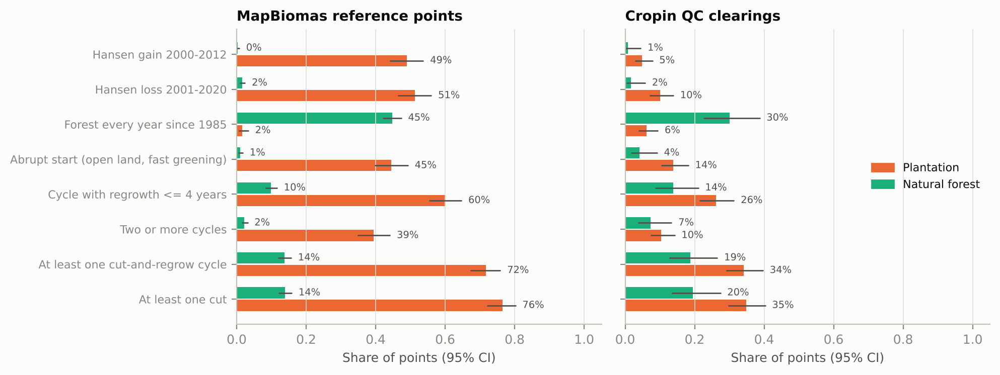
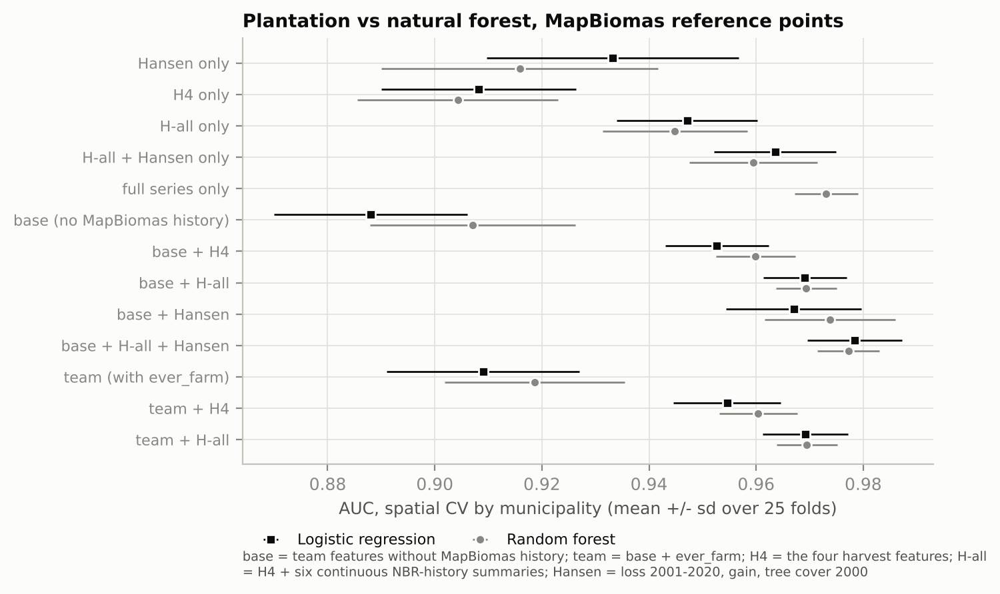

# Harvest cycles: does a pixel's cut-and-regrow history identify plantations?

## Bottom line
- **Yes. The Landsat harvest history is a strong, verified plantation signal.**
  - On the MapBiomas points, most plantations show a clear-cut before 2021 (76%), an abrupt start on open land
    (45%), or both. Most natural forest shows no cut (86%).
  - On its own, the history separates the two better than the team's current features (AUC 0.95 vs 0.91–0.92).
  - Hansen's loss/gain record adds about as much on the MapBiomas points, but less on Cropin's QC set.
- **MapBiomas reference points: upper bound.** Adding the history to the team's features raises spatial-CV AUC from
  0.91–0.92 to 0.97, in all 25 held-out folds and in every state held out.
  - At ≤ 5% of forest flagged, recall rises from 64% to 88%, on a par with MapBiomas 10 m (86%; McNemar p = 0.49).
  - Upper bound because MapBiomas' interpreters label these points from the same Landsat archive.
- **Cropin's QC clearings: the independent test.** Most are smaller than one Landsat pixel.
  - Trained only on MapBiomas points, QC AUC ranges from 0.67 (the four features alone) to 0.81 (the full yearly
    series); H-all gives 0.74–0.76.
  - The models catch 33–45% of QC plantations at 6–9% of QC forest flagged; MapBiomas catches 4% (midterm slides).
- **"Forest every year since 1985" works as a veto, but it has a cost.**
  - It protects 45% of real forest and wrongly vetoes 1.6% of plantations.
  - On Cropin's QC clearings: 30% and 6.1%.
- **Best use of the series:** continuous summaries, not counts of cycles. How much NBR varied over 1985–2020 is
  best (AUC 0.97 / QC 0.76), then the lowest NBR. Regrowth speed does not work.
- **Verification.** Every number below was re-derived independently and reproduced from the raw data (see the last
  section).

## Data and method
- **Imagery.** Landsat 4/5/7/8 Collection 1 top-of-atmosphere reflectance, **1985–2020 only** (EUDR cutoff).
  - 8,063 low-cloud scenes, read pixel by pixel from Google's public bucket.
  - A median of 6 clear observations per point and year; 0.4% of point-years have none (worst year: 1998).
  - Landsat 5 and 8 are put on the Landsat 7 scale using same-point pairs.
- **Index.** NBR (near-infrared vs shortwave-infrared 2). It drops sharply at a clear-cut and climbs back as trees
  regrow. NDVI was run for comparison.
- **Points**
  - **MapBiomas reference points:** the team's 1,831 points (429 plantation, 1,402 forest).
  - **Cropin QC clearings:** 433 polygons (310 plantation, 123 forest; median ~270 m²), one Landsat pixel at each.
    Only aggregates are committed.
- **Thresholds come from Hansen tree cover, never from the labels, and use information up to 2020 only.**
  - Closed canopy: NBR 0.584. Open land: NBR 0.405.
  - A **cut** is an NBR fall of ≥ 0.20 within ≤ 3 years. A **cycle** is a cut that regrows half the fall within
    10 years.
- **Primary configuration.** NBR, yearly median of all clear observations, LandTrendr-style piecewise-linear
  segmentation (up to 18 segments, model size by BIC). Everything else is a comparison.
- **Reference.** Hansen Global Forest Change (loss 2001–2020, gain 2000–2012).

## 1. The four features

Examples of yearly NBR, the segmentation and detected cuts: `figures/examples_segmentation.png`.

| Feature (before 2021) | Plantation | Forest | Odds ratio (95% CI) | QC plantation | QC forest | QC odds ratio |
|---|---|---|---|---|---|---|
| At least one cut | 76% | 14% | 20 (15–26) | 35% | 20% | 2.2 (1.3–3.6) |
| At least one cut-and-regrow cycle | 72% | 14% | 16 (12–21) | 34% | 19% | 2.3 (1.4–3.8) |
| Two or more cycles | 39% | 2.2% | 29 (19–43) | 10% | 7% | 1.5, n.s. |
| A cycle regrowing within 4 years | 60% | 10% | 14 (11–18) | 26% | 14% | 2.2 (1.2–3.9) |
| Abrupt start: ≥ 3 open years, then canopy within 5 years | 45% | 1.1% | 74 (43–128) | 14% | 4.1% | 3.8 (1.5–9.8) |
| Forest every year since 1985, no cut | 1.6% | 45% | 0.021 (0.010–0.044) | 6.1% | 30% | 0.15 (0.08–0.28) |
| *Hansen loss 2001–2020* | *51%* | *1.6%* | *66 (42–105)* | *10%* | *1.6%* | *6.7 (1.6–29)* |
| *Hansen gain 2000–2012* | *49%* | *0.3%* | *335 (123–911)* | *4.8%* | *0.8%* | *6.2 (0.8–47), borderline* |

- **MapBiomas points:** every feature is significant (Fisher p < 10⁻⁷⁹; logistic regression with standard errors
  clustered by municipality, p < 10⁻²³).
- **QC**
  - Cut, cycle, fast regrowth and abrupt start are significant but weak: Fisher p = 0.002–0.005, clustered p =
    0.005–0.02.
  - "Forest since 1985" is strong (p = 3 × 10⁻¹⁰).
  - Two or more cycles is not significant (p = 0.37); Hansen gain is borderline (Fisher p = 0.049, clustered 0.09).
- **Regrowth time does not separate.**
  - With a cycle, plantations regrow 80% of the fall in a median of 1.7 years and forest in 1.8 (p = 0.39; QC
    p = 0.71).
  - Medians are 1.4–2.2 years in every group, likely because NBR recovers within about two years for any woody
    regrowth.
- **Abrupt start catches about half of the plantings on open land.** Among plantations the reference shows planted
  on ≥ 3 years of pasture or crops, 52% are caught. Yearly pasture NBR is often above the open-land level, but our
  canopy-closure year matches the reference planting year (median difference 0 years).
- **Continuous summaries of the same history separate much better:**

  | Summary of the yearly NBR, 1985–2020 | AUC, MapBiomas points (95% CI) | AUC, QC (95% CI) |
  |---|---|---|
  | Variability (standard deviation) | 0.97 (0.96–0.98) | 0.76 (0.71–0.82) |
  | Lowest value | 0.93 | 0.72 |
  | Largest 3-year fall | 0.91 | 0.70 |
  | Share of years below closed canopy | 0.86 | 0.72 |
  | Number of cuts | 0.84 | 0.58 |

## 2. Added value over the team's features (MapBiomas points, spatial CV)
**Set-up.** Same as the team's run B: 1,830 rows, GroupKFold by municipality, balanced logistic regression (LR) and
random forest (RF), 5 repeats (25 held-out folds).

**Feature sets**
- **Base:** the team's features without `ever_farm`, which is MapBiomas history.
- **Team:** base plus `ever_farm`.
- **H4:** the four features.
- **H-all:** H4 plus number of cuts, years since the last cut, largest cut, share of years below closed canopy,
  lowest NBR, and largest 3-year fall.

| AUC | Base | + H4 | + H-all | + Hansen | + H-all + Hansen | Team | Team + H-all |
|---|---|---|---|---|---|---|---|
| LR | 0.888 | 0.953 | 0.969 | 0.967 | 0.978 | 0.909 | 0.969 |
| RF | 0.907 | 0.960 | 0.969 | 0.974 | 0.977 | 0.919 | 0.969 |

- **Every H4 or H-all addition improves all 25 folds, for both models: +0.042 to +0.081 AUC.**
  - Municipality-bootstrap 95% CIs exclude zero (RF base → base + H-all: +0.065, CI +0.049 to +0.081).
  - Holding out a whole state, the gain is +0.04 to +0.11, and every state ends at AUC 0.96–0.98.
  - Hansen alone adds about as much on these points (+0.07 to +0.08); combining both is best (0.977–0.978).
  - NBR variability on top (post hoc) adds +0.008 to +0.011.
- **The history alone (H-all) reaches 0.945–0.947,** above the team's features. A random forest on the 36 yearly
  values and their year-to-year changes reaches 0.973.
- **Significance in a joint model** (logistic regression on base + H4, municipality-clustered errors):
  - Odds ratios: cycles 2.9 per SD (2.0–4.0), forest since 1985 0.10 (0.045–0.23), abrupt start 20 (10–40).
  - Regrowth speed is not significant (0.90, 0.69–1.17).
  - The four together: Wald χ² = 189, df = 4, p ≈ 10⁻³⁹.
  - SAG keeps its effect (4.4 per SD), so the history adds to SAG rather than replacing it.

**At an operating point.** Thresholds were picked on the same out-of-fold scores, so slightly optimistic.

| Model (RF unless noted) | Recall at ≤ 5% forest flagged | at ≤ 1% | Plantations MapBiomas 10 m calls forest, caught (of 39) | Forest MapBiomas 10 m calls plantation, also flagged (of 72) |
|---|---|---|---|---|
| Team | 64% | 31% | 10 | 17 |
| Team + H-all | 88% | 62% | 26 | 9 |
| Base + H-all + Hansen | 91% | 70% | 27 | 11 |
| Base + H-all + variability (LR, post hoc) | 92% | 81% | 26 | 12 |
| *MapBiomas 10 m itself* | *86% (at 5.1%)* | – | – | – |

- **Team + H-all vs MapBiomas 10 m** at the same false-alarm rate: 88% vs 86% of plantations (McNemar p = 0.49) and
  4.9% vs 5.1% of forest (p = 0.79). That is no significant difference; the team features alone were at 64%.
- **MapBiomas disagreement groups.** These compare the 10 m map with a reference drawn from Landsat, so agreement
  with the reference is partly built in.
  - Plantations MapBiomas 10 m calls forest: 68% show a cut, vs 13% of real forest (Fisher p = 10⁻¹⁴).
  - Points it calls plantation where the reference says forest: 24% (p = 0.02).

## 3. The best ways to use the time series
Paired AUC differences with 95% CIs are in `results/method_comparison_paired_ci.csv`.

1. **Feed continuous summaries to the model, not counts.**
   - NBR variability vs cut count: +0.13 AUC (CI +0.11 to +0.15) on MapBiomas points and +0.19 (+0.14 to +0.23) on
     QC.
   - Summaries vs counts are the only comparisons significant on QC.
2. **Use NBR, not NDVI.** For the cut count, +0.09 AUC (CI +0.07 to +0.11) on MapBiomas points; NDVI saturates over
   canopy. On QC the difference is not significant.
3. **Use the yearly median of all clear observations.**
   - Wet-season median: slightly better for rule-based counts (+0.024, CI +0.002 to +0.045).
   - Dry-season median: twice the false cuts in forest (25% vs 12%); deciduous forest is leafless in winter.
   - Yearly maximum: worse (−0.074), because it keeps the pre-cut image.
4. **Allow enough segments.**
   - With 6 (LandTrendr's usual setting) a pixel can hold only about 2 cuts, and the cut count loses 0.058 AUC
     (CI 0.041–0.078).
   - At 18, segmentation and simple rules on the yearly values are equivalent: 76–77% of plantations and 12–14% of
     forest have a cut (AUC difference +0.005, CI −0.013 to +0.023).
   - In LandTrendr also raise `recoveryThreshold`: the default 0.25 forbids eucalyptus-speed regrowth.
5. **Drop threshold 0.15–0.25 NBR.** The rules find a cut in 90% / 77% / 67% of plantations and 26% / 12% / 5% of
   forest at 0.15 / 0.20 / 0.25.
6. **Add Hansen loss/gain.** It is free and very specific (1.6% of forest has a loss), but misses half the
   plantations: it only sees losses after 2000, one per pixel.
7. **Use the pixel itself.** A 3×3 neighbourhood was tested (commit 67b7b9a) and did not help on QC, so it was
   dropped. QC AUC (H-all + variability, LR): 0.80 with the centre pixel, 0.75 with a 90 m mean series.

## 4. The veto: "forest every year since 1985" can only cancel a plantation call
Passing means no cut, and yearly NBR never below closed canopy (tolerance = years allowed below).

| | Tolerance 0 | 1 year | 2 years | 1993–2020 only, tolerance 0 |
|---|---|---|---|---|
| MapBiomas points: forest protected / plantations wrongly vetoed | 45% / **1.6%** | 57% / 2.6% | 62% / 3.3% | 59% / 4.0% |
| **Cropin QC: forest protected / plantations wrongly vetoed** | 30% / **6.1%** | 41% / 12.6% | 50% / 14.2% | 47% / 12.6% |
| MapBiomas 10 m plantation calls on reference forest cancelled (of 72) | 29 | 37 | 39 | 43 |
| MapBiomas 10 m correct plantation calls lost (of 369) | 5 | 9 | 10 | 14 |
| Team-features RF without `ever_farm` (≤ 5% FPR): forest flags cancelled (of 69) / plantation flags lost (of 250) | 22 / 3 | 29 / 5 | 34 / 8 | 29 / 7 |

- At tolerance 0, as a post-filter on MapBiomas or on a model without harvest features, it removes a third to
  two-fifths of the forest flags.
- The cost is 1–2% of correct plantation calls on the MapBiomas points, and about 6% on Cropin-type clearings.
- Inside a model that already has the harvest features, it adds nothing.
- **Pre-1993 years.** Half of the forest points with a "cut" (48%) have it only in 1986–1992, which only Landsat 4/5
  TM covers and Hansen cannot check. Ignoring those years is not a free fix: it protects more forest but vetoes 2.5×
  as many plantations (last column).

## 5. Cropin's QC clearings (independent test)
Models are trained only on MapBiomas points. The threshold is the one giving ≤ 5% false alarms there.

| Features | QC AUC (95% CI) | QC plantations caught | QC forest flagged |
|---|---|---|---|
| H4 (LR) | 0.67 (0.62–0.73) | 23% | 10% |
| Hansen (LR) | 0.70 (0.64–0.75) | 28% | 5% |
| H-all (LR; RF 0.74) | 0.76 (0.70–0.81) | 33% | 7% |
| H-all + Hansen (LR) | 0.77 (0.72–0.82) | 38% | 7% |
| H-all + variability (LR, post hoc) | 0.80 (0.74–0.84) | 45% | 9% |
| The 36 yearly NBR values and their year-to-year changes (RF) | **0.81 (0.77–0.85)** | **43%** | **6%** |

On the same QC set, the midterm slides report that MapBiomas catches 4% of these plantations, and that Google's
Natural Forests layer catches 23% while hiding 6% of forest.

**Why QC is harder** (yearly NBR by group: `figures/nbr_trajectories_by_group.png`)
- **Size.** Patches over 2,700 m² (n = 11) show a cut 64% of the time, close to MapBiomas plantations (76%);
  smaller ones only 33–36%.
- **No recent rotation at 30 m.** Only 8% of QC plantations show a cut in 2010–2020 (forest: 0%). Their cuts are
  mostly 1986–2008, and by 2016–2020 they are at closed canopy, so at 30 m they look like older woodlots rather than
  7-year rotations.
- **QC forest sits in farm landscapes.** 20% show a "cut" and 70% fail "forest since 1985"; on MapBiomas points those
  figures are 14% and 55%.

## 6. What fools it
- **Forest regrown on former farmland has nearly three times the false-cut rate.** Forest with a non-forest year in
  the reference: 33% false cuts, 7% pass the veto. Forest every year: 12% and 49%. Most false cuts (149 of 195) are
  still in always-forest points; about half of all false cuts fall only before 1993 (§4).
- **Bracatinga: no excess.** Forest within 80 km of Curitiba has 12% false cuts vs 14% elsewhere (crude zone).
- **First-rotation stands are missed.** Share of plantations with a cut, by the year the reference first calls them
  plantation: 1985: 94%; 1986–2000: 80%; 2001–2013: 67%; 2014–2020: 44% (n = 16). Abrupt start catches 38–50% of
  those established after 1985.

## 7. Caveats
- **Labels.** MapBiomas reference labels are not independent of Landsat, so every MapBiomas-point result is an upper
  bound. The gain over the team's features cannot be checked on QC, because the team's features do not exist there.
- **Changes after review (post hoc).** After an independent code review, once first results had been seen:
  - segment cap 6 → 18;
  - open-land level 0.30 → 0.405 (abrupt start in plantations 15% → 45%, forest 0.2% → 1.1%);
  - closed-canopy level 0.546 → 0.584, using information up to 2020 only;
  - the variability feature set added.

  Only the cap change was re-run as a model: with the cap-6 features, base + H-all is 0.969–0.971, the same.
- **Method**
  - Collection 1 top-of-atmosphere reflectance; Earth Engine's Collection 2 needs new levels (the GEE script
    calibrates them).
  - Our segmentation is LandTrendr-like, not LandTrendr itself.
- **Small numbers.** Only 39–40 plantations are missed by MapBiomas 10 m. QC uses one pixel per clearing.

## 8. Recommendations
1. **Add H-all, and Hansen loss/gain, to the model.**
   - On MapBiomas points each adds +0.05 to +0.08 AUC, and both together are best.
   - On Cropin's QC set the harvest history transfers better than Hansen (0.74–0.76 vs 0.68–0.70).
   - NBR variability is a promising post hoc addition; confirm it on new data.
2. **Use "forest since 1985" (tolerance 0) as a veto** on plantation calls from MapBiomas or any model without
   harvest features. Expect it to cancel ~6% of real plantations on Cropin-type clearings. Never use it to create a
   call.
3. **Run `gee/landtrendr_harvest_features.js`** (CALIBRATE, then EXPORT) and compare it with this analysis via
   `scripts/features_from_gee_export.py`. Then map the features for the 10 m layer.
4. **Ask Cropin:**
   - which index and settings their CCDC/LandTrendr runs used
   - how they label fallow regrowth and bracatinga
   - whether the QC plantations are older farm woodlots

## Verification
Five independent verifiers each wrote their own code and checked one block, and the pipeline was rerun end to end.
All numbers above match.
- **Reproducibility.** Steps 6–8 were rerun from the raw extraction after trimming. Every result table was
  reproduced exactly (largest difference 3 × 10⁻¹⁶).
- **Raw data.**
  - 40 Landsat observations re-read from Google Cloud and 30 Hansen pixels re-read from the GFC tiles match the
    stored values exactly.
  - The raw-to-yearly-series chain, re-implemented independently, matches for all 2,264 points.
  - No data after 2020 enters any feature.
- **Statistics.** Re-implemented from scratch with 0 mismatches:
  - the four-feature tables, the veto and the strata (53 checks);
  - all 475 cross-validation fold AUCs, the operating points, the clustered logit and the QC transfer (31 checks).
- **Independent sources** (`results/analysis_log.txt`, section 9)
  - Of the 275 points with a Hansen loss in 2001–2020, the segmentation finds a cut at 85%, and 81% show an NBR fall
    of ≥ 0.20 within a year of Hansen's loss year.
  - For plantations planted on open land, our canopy-closure year falls a median of 0 years from the MapBiomas
    reference planting year (84% within −1 to +3 years).
- **Robustness.** The gain from adding H-all is positive in every one of these tests:
  - leave-one-state-out (in the log);
  - 20 random fold splits (99–100 of 100 folds improved);
  - 0.5° spatial blocks;
  - 2020 instead of 2022 labels;
  - only points where at least 2 interpreters agreed.

  The QC transfer AUC moves by at most 0.005 across random-forest seeds.
- **Document audit.** All 172 numbers and claims in the previous version were checked against the result files. The
  numbers matched; the overstated wording found by the audit is corrected here.
